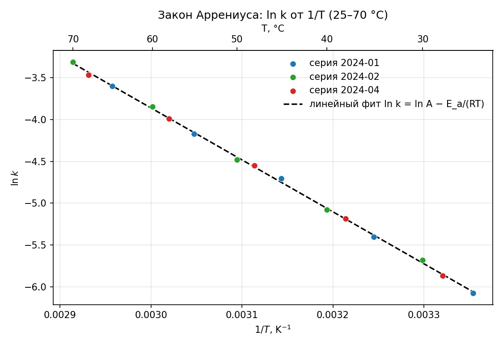

# Проверка закона Аррениуса в интервале 25–70 °C

**Резюме.** Разложение подчиняется закону Аррениуса в интервале 25–70 °C: линейный фит
ln k от 1/T по трём сериям измерений даёт энергию активации **E_a = 51.663 кДж/моль**
(ln A = 14.780, R² = 0.999259). Независимый пересчёт нелинейным фитом методом
Гаусса–Ньютона подтверждает результат: **E_a = 51.447 ± 0.698 кДж/моль** — совпадение в
пределах погрешности.

---

## 1. Постановка задачи

Закон Аррениуса связывает константу скорости реакции с температурой экспоненциально
[[Arrhenius 1889]]:

$$
k(T) = A \exp\!\left(-\frac{E_a}{R T}\right),
$$

где $E_a$ — энергия активации, $R = 8.314462618$ Дж/(моль·К) — газовая постоянная,
$A$ — предэкспоненциальный множитель. В логарифмическом виде зависимость линейна по
$1/T$:

$$
\ln k = \ln A - \frac{E_a}{R}\cdot\frac{1}{T}.
$$

Задача — проверить, подчиняется ли разложение закону Аррениуса в интервале 25–70 °C,
и оценить энергию активации по данным `data/raw/rates.csv`.

## 2. Данные

Набор `data/raw/rates.csv` содержит четыре серии измерений константы скорости от
температуры (по 5 точек, 25–70 °C). Серия **2024-03** измерена с неисправным
термостатом и в расчёт **не включается** (ограничение). В анализ вошли серии
2024-01, 2024-02 и 2024-04 — всего 15 точек.

## 3. Методы и эксперименты

### 3.1. Линейный фит (основной расчёт)

Эксперимент «Расчёт E_a по трём сериям» (`src/fit_arrhenius.py`): линейная регрессия
ln k от 1/T по 15 точкам. Наклон $b = -E_a/R$, откуда $E_a = -bR$.

### 3.2. Независимый пересчёт (проверка)

Проверка «Независимый пересчёт E_a» (`src/verify_arrhenius.py`): нелинейный фит
экспоненты $k = A\exp(-E_a/(RT))$ методом Гаусса–Ньютона без линеаризации — по тем же
15 точкам. Это независимый способ оценки, не опирающийся на линеаризацию.

## 4. Результаты

| Величина | Линейный фит | Независимый пересчёт | Единицы |
|----------|:------------:|:--------------------:|:-------:|
| E_a      | 51.663       | 51.447 ± 0.698       | кДж/моль |
| ln A     | 14.780       | 14.701               | ln(1/с)  |
| R²       | 0.999259     | —                    | —        |
| точек    | 15           | 15                   | —        |

Высокий коэффициент детерминации R² = 0.999259 подтверждает линейность ln k от 1/T,
т. е. гипотеза Аррениуса **не опровергнута**. Разница между оценками E_a
(51.663 − 51.447 = 0.216 кДж/моль) меньше погрешности независимого пересчёта
(±0.698 кДж/моль) — результаты согласованы.

## 5. График

Точки трёх серий ложатся на общую прямую; линия линейного фита проходит через них.
Верхняя ось показывает температуру в °C.

## 6. Вывод

Закон Аррениуса выполняется в интервале 25–70 °C. Энергия активации разложения
составляет **E_a ≈ 51.6 кДж/моль**; результат подтверждён независимым пересчётом
другим методом в пределах погрешности. Смысл энергии активации и предэкспоненциального
множителя обсуждается в [[Laidler 1984]].

## 7. Источники

- [[Arrhenius 1889]] — введение экспоненциальной зависимости константы скорости от обратной температуры.
- [[Laidler 1984]] — история уравнения Аррениуса, смысл E_a и предэкспоненциального множителя.

## Связи
- тип: [[Отчёт]]
- описывает: [[Расчёт E_a по трём сериям]]
- описывает: [[Результат E_a по трём сериям]]
- описывает: [[Независимый пересчёт E_a]]
- ссылаетсяНа: [[Arrhenius 1889]]
- ссылаетсяНа: [[Laidler 1984]]
- выполняет: [[Построить график Аррениуса]]
- выполняет: [[Написать отчёт]]
- выполняет: [[Написать отчёт о проверке закона Аррениуса]]