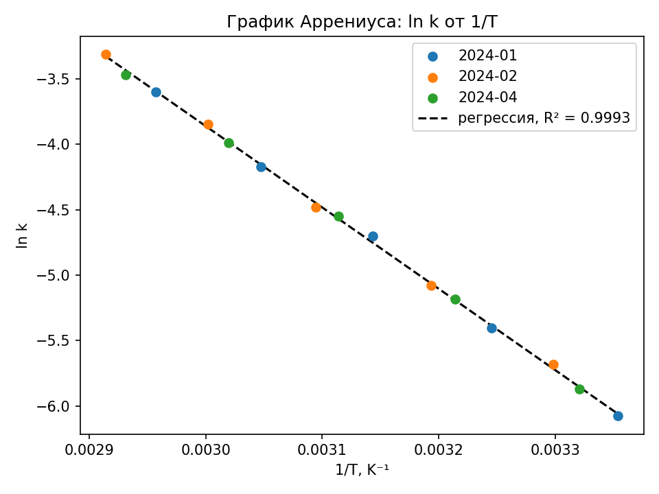

# Отчёт: закон Аррениуса и энергия активации разложения

## Постановка

Проверяли, подчиняется ли разложение закону Аррениуса в интервале 25–70 °C, и определяли энергию активации E_a по константам скорости первого порядка из `data/raw/rates.csv`. Уравнение Аррениуса связывает константу скорости с температурой экспоненциально: ln k = ln A − E_a/(RT), то есть ln k линейно зависит от 1/T [[Arrhenius 1889]]. Смысл энергии активации и предэкспоненциального множителя разобран в [[Laidler 1984]].

## Данные и метод

Четыре серии по пять точек; серия 2024-03 исключена из-за неисправного термостата (перегрев ячейки ~12 K при уставках ниже 50 °C). Расчёт — метод наименьших квадратов для регрессии ln k от 1/T по 15 точкам трёх серий (2024-01, 2024-02, 2024-04); наклон даёт −E_a/R [[Laidler 1984]]. Температура переведена в кельвины (T = T_C + 273,15).

## Результат

Регрессия дала R² = 0,9993 — линейность подтверждена, разложение подчиняется закону Аррениуса. Энергия активации E_a = 51,66 кДж/моль. Независимый двухточечный пересчёт по крайним точкам каждой серии дал 51,23–51,89 кДж/моль — согласуется.

## Связи
- тип: [[Отчёт]]
- описывает: [[Эксперимент проверка линейности]]
- описывает: [[Эксперимент расчёт E_a]]
- описывает: [[Энергия активации разложения]]
- ссылаетсяНа: [[Arrhenius 1889]]
- ссылаетсяНа: [[Laidler 1984]]
- выполняет: [[Написать отчёт для коллег]]